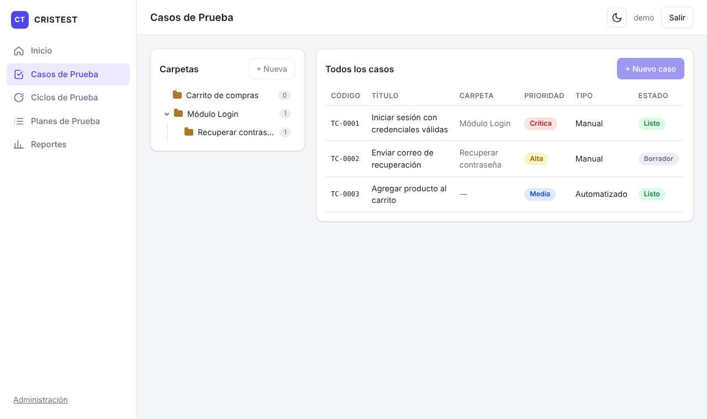
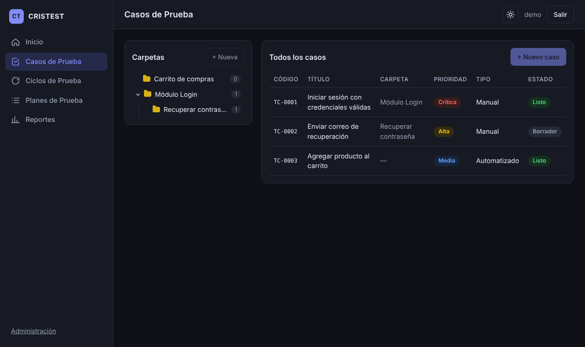

# CRISTEST

Sistema web para gestionar **casos de prueba, planes, ciclos de ejecución y métricas de QA**, construido con Python y Django.

Proyecto de portafolio de QA (pruebas manuales y automatizadas).

| Modo claro | Modo oscuro |
|---|---|
|  |  |

## Funcionalidades

- **Casos de Prueba**: código automático (`TC-0001`), pasos con resultado esperado, prioridad, tipo (manual/automatizado), estado y etiquetas.
- **Planes de Prueba**: agrupan casos y tienen un alcance y fechas.
- **Ciclos de Prueba**: ejecutan los casos de un plan contra una versión y un entorno (pasó, falló, bloqueado, omitido o no ejecutado) y muestran su avance.
- **Carpetas desplegables** anidadas y separadas por sección.
- **Reportes** de métricas (en desarrollo).
- Interfaz en español con **modo claro/oscuro**. El tema se guarda en el navegador y, si no eliges uno, sigue el del sistema.

## Hoja de ruta (MVP)

1. ✅ Base del proyecto y modelo de datos: login, diseño con menú lateral, modo oscuro y administración.
2. ⏳ Gestión completa desde la interfaz: crear, editar, mover y eliminar carpetas, casos, planes y ciclos, y ejecutar ciclos.
3. ⏳ Importar/exportar casos (CSV/Excel) y dashboard de reportes con gráficas.
4. ⏳ Pruebas E2E con Playwright, datos de ejemplo y despliegue.

Siguientes fases: CI/CD e integración de resultados de pruebas automatizadas.

## Tecnología

- Python 3.12+ y Django 5.2
- django-treebeard para el árbol de carpetas
- Plantillas de Django, CSS propio con variables de tema y HTMX
- SQLite en desarrollo
- pytest y pytest-django

## Cómo ejecutarlo

```bash
python -m venv .venv
source .venv/bin/activate        # En Windows: .venv\Scripts\activate
pip install -r requirements-dev.txt
python manage.py migrate
python manage.py createsuperuser
python manage.py runserver
```

Abre http://127.0.0.1:8000 e inicia sesión. Por ahora los datos se capturan desde **Administración** (`/admin/`); la gestión desde cada sección llega en el paso 2.

## Pruebas

```bash
pytest
```

## Modelo de datos

```
Carpeta (árbol por sección)
├── CasoDePrueba ── PasoDePrueba
├── PlanDePrueba ── casos (muchos a muchos)
└── CicloDePrueba ── Ejecucion (caso + estado + comentario)
```
