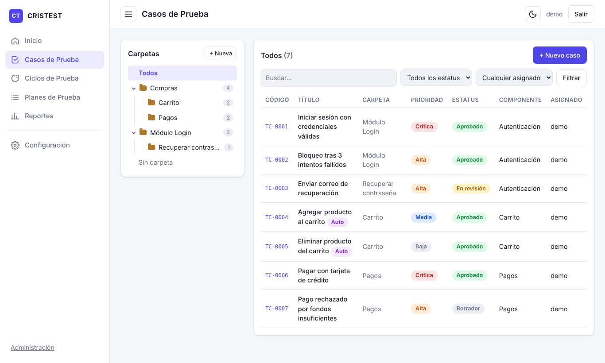
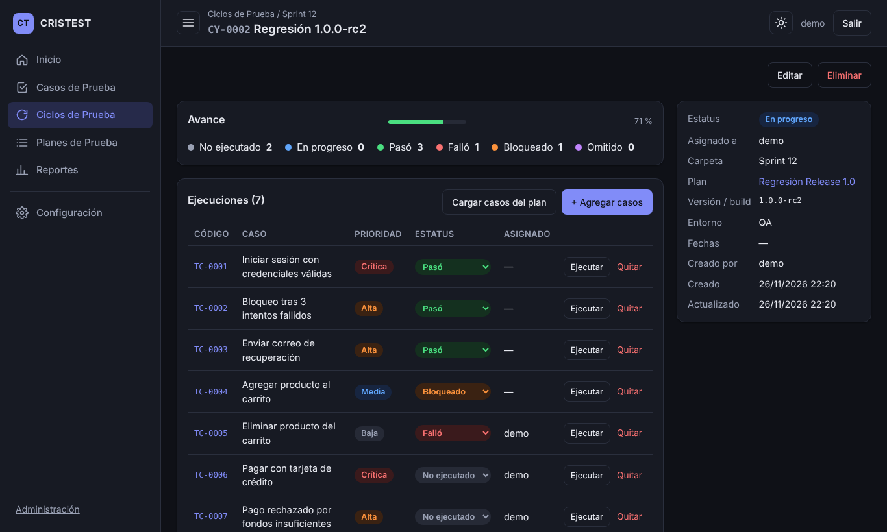
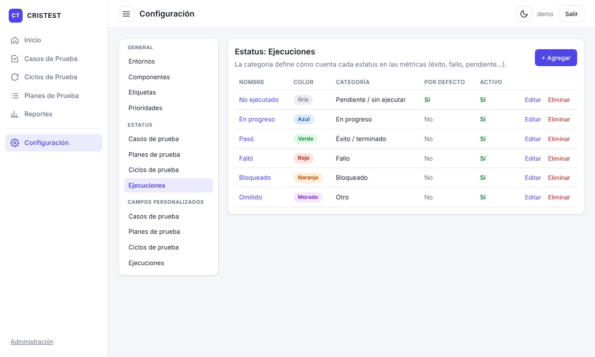
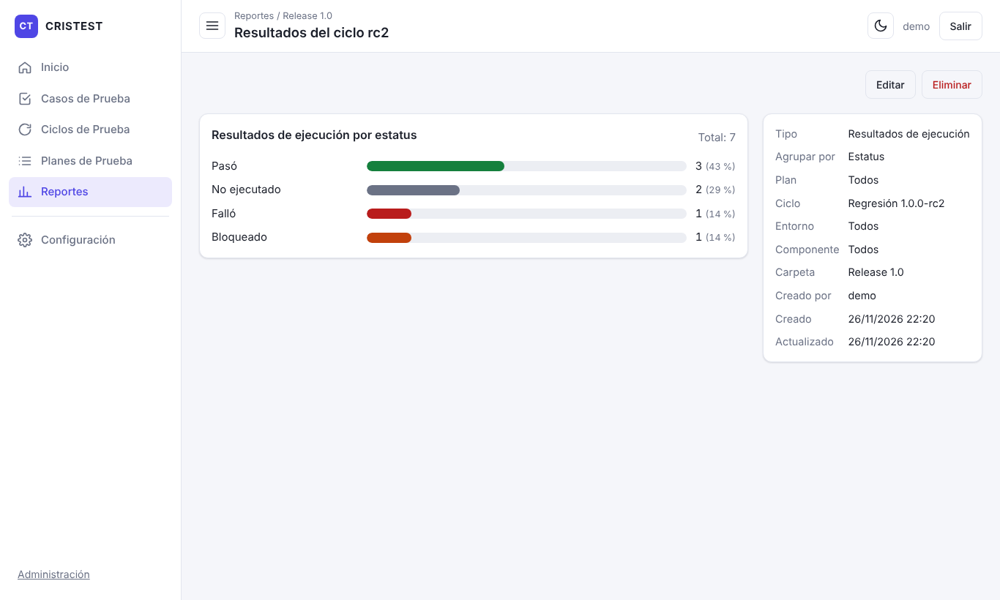

# CRISTEST

Sistema web para gestionar **casos de prueba, planes, ciclos de ejecución y métricas de QA**, construido con Python y Django. Toma como referencia herramientas como Zephyr y TestRail.

Proyecto de portafolio de QA (pruebas manuales y automatizadas).

| Casos de prueba | Ciclo de prueba (modo oscuro) |
|---|---|
|  |  |
| **Configuración** | **Reporte** |
|  |  |

## Funcionalidades

- **Carpetas desplegables** anidadas en cada sección: crear, renombrar, mover a otra carpeta, eliminar y filtrar (incluye subcarpetas).
- **Casos de Prueba**: código automático (`TC-0001`), objetivo, precondiciones, pasos con datos y resultado esperado (agregar, reordenar, eliminar), prioridad, estatus, componente, tipo (manual/automatizado), asignado, etiquetas y campos personalizados. Se pueden duplicar.
- **Planes de Prueba**: agrupan casos, con alcance, fechas, estatus y asignado.
- **Ciclos de Prueba**: ejecutan casos contra una versión y un entorno. Puedes cargar los casos del plan, cambiar el estatus desde la tabla o ejecutar paso a paso con comentarios («Guardar y siguiente pendiente»), y ver el avance.
- **Reportes**: reportes guardados con filtros (plan, ciclo, entorno, componente) y agrupación (estatus, prioridad, componente, asignado, tipo o ciclo).
- **Configuración** (estilo Zephyr):
  - General: entornos, componentes, etiquetas y prioridades.
  - Estatus por tipo de elemento (casos, planes, ciclos, ejecuciones), con color, categoría para métricas y valor por defecto.
  - Campos personalizados por tipo de elemento: texto, texto largo, número, fecha, lista o casilla, opcionales u obligatorios.
- Búsqueda y filtros por estatus y asignado.
- Menú lateral tipo hamburguesa que se oculta para usar todo el ancho y recuerda su estado.
- Interfaz en español con **modo claro/oscuro**, adaptada a móvil.

## Hoja de ruta (MVP)

1. ✅ Base del proyecto y modelo de datos.
2. ✅ Gestión completa desde la interfaz, módulo de configuración y reportes básicos.
3. ⏳ Importar/exportar casos (CSV/Excel) y dashboard de métricas con gráficas.
4. ⏳ Pruebas E2E con Playwright y despliegue.

Siguientes fases: CI/CD e integración de resultados de pruebas automatizadas.

## Tecnología

- Python 3.12+ y Django 5.2
- django-treebeard para el árbol de carpetas
- Plantillas de Django, CSS propio con variables de tema y HTMX (incluido en `static/vendor`, sin CDN)
- SQLite en desarrollo
- pytest y pytest-django

## Cómo ejecutarlo

```bash
python -m venv .venv
.venv\Scripts\activate           # En macOS/Linux: source .venv/bin/activate
pip install -r requirements-dev.txt
python manage.py migrate         # crea las tablas y la configuración inicial
python manage.py createsuperuser
python manage.py cargar_demo     # opcional: datos de ejemplo
python manage.py runserver
```

Abre http://127.0.0.1:8000 e inicia sesión.

## Pruebas

```bash
pytest
```

## Modelo de datos

```
Configuración: Entorno, Componente, Etiqueta, Prioridad, Estatus (por ámbito), CampoPersonalizado

Carpeta (árbol por sección)
├── CasoDePrueba ── PasoDePrueba
├── PlanDePrueba ── casos (muchos a muchos)
├── CicloDePrueba ── Ejecucion (caso + estatus + comentario)
└── Reporte (filtros + agrupación)
```

Los valores de los campos personalizados se guardan en `campos_extra` (JSON) de cada elemento.
